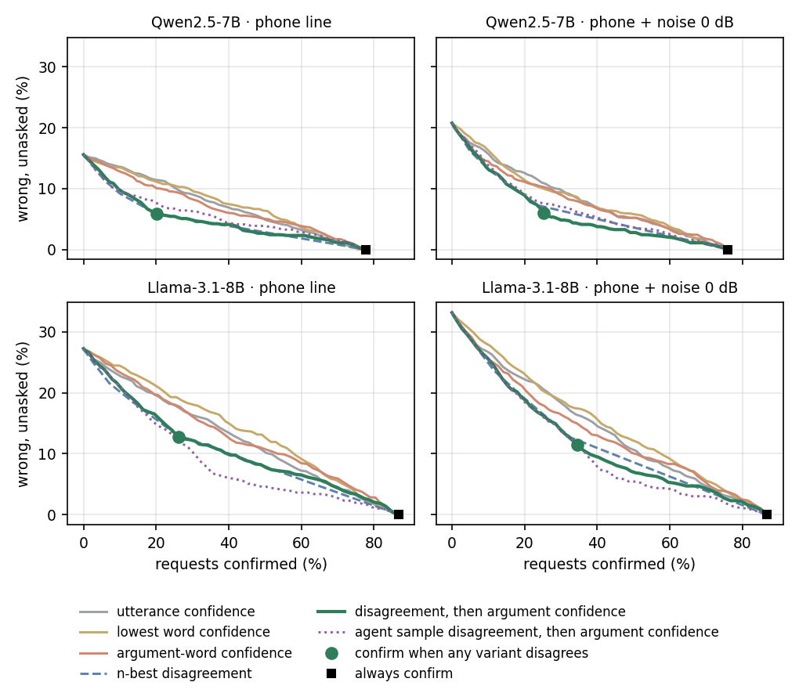

# confirm-before-acting

**Paper:** Masood Ahmed (2026). *Read It Back When the Action Is Unstable: Confirmation Policies for Spoken Tool Calling.* Preprint, Zenodo. [doi:10.5281/zenodo.24432452](https://doi.org/10.5281/zenodo.24432452)

When should a voice agent read an action back ("Area of a triangle, base 10, height 5, is that right?") before doing it? Confirm everything and the agent is unbearable; confirm nothing and it acts on misheard words and its own misreadings. This project measures which signal tells you *when* to ask, on 829 spoken tool-calling requests, six listening conditions and two open agents.

Short version: the recogniser's confidence is a weak guide. A much better one is **whether the agent's action holds when you nudge it**. Handing the agent the recogniser's other likely transcripts is one good nudge: confirming only the requests where its action changes asks about 1 in 4 times and stops two-thirds of wrong actions (Qwen2.5-7B: 16.6% → 5.8% of requests acted on wrongly without asking, at 20.7% asked, phone line with 10 dB noise). At the same budget, ranking by utterance confidence leaves 3 to 5 points more wrong actions, on both agents and all four conditions without background chatter. Re-sampling the agent on the one transcript works about as well at the same budget, and using both nudges together is best (4 to 5% wrong actions left). With loud background chatter, most requests are misheard and recogniser confidence catches up.



The paper's LaTeX source is in [`paper/`](paper); every number in it is generated by `make_paper.py`. The PDF is on [Zenodo](https://doi.org/10.5281/zenodo.24432452).

## Results

Every request is played through six conditions: the clean benchmark audio, a phone line (300-3400 Hz, 8 kHz G.711 mu-law), the phone line with environmental noise at 10 dB and 0 dB SNR, and the phone line with background chatter (three other talkers from the benchmark) at 5 dB and 0 dB. Whisper large-v3-turbo transcribes it and returns word probabilities and a 5-best list; Whisper large-v3 gives a second, independent transcript. The agent turns a transcript into a tool call; it also sees the clean transcript ("what was said"), which is the reference for what the user meant. Thresholds for every ranked policy are chosen on one half of the requests and applied to the other half, both ways (cross-fitting), so no policy is tuned on the requests it is scored on. Brackets are 95% paired bootstrap intervals.

**The main measure is a wrong action taken without asking.** A read-back stops a wrong action whatever caused it, because the user says no. Requests where the agent takes no action have nothing to confirm; missed actions are counted separately (without chatter, Qwen 22 to 30 of 829 and Llama 0 to 2; with chatter at 0 dB, 181 and 55, because a garbled request often matches no tool).

| agent | condition | never confirm | confirm when any variant disagrees | utterance confidence, 20% budget | disagreement + argument confidence, 20% budget | difference [95% CI] |
| --- | --- | --- | --- | --- | --- | --- |
| Qwen2.5-7B | clean | 14.8% | **5.1%** (21.8% asked) | 10.0% | 6.4% | -3.6 [-5.4, -1.7] |
| Qwen2.5-7B | phone line | 15.6% | **5.8%** (20.1% asked) | 10.9% | 6.4% | -4.5 [-6.3, -2.5] |
| Qwen2.5-7B | phone + noise 10 dB | 16.6% | **5.8%** (20.7% asked) | 11.2% | 6.4% | -4.8 [-6.8, -3.0] |
| Qwen2.5-7B | phone + noise 0 dB | 20.7% | **6.0%** (25.3% asked) | 12.3% | 8.4% | -3.9 [-5.5, -2.1] |
| Qwen2.5-7B | phone + chatter 5 dB | 22.2% | **4.1%** (32.6% asked) | 13.1% | 9.7% | -3.5 [-5.5, -1.7] |
| Qwen2.5-7B | phone + chatter 0 dB | 32.0% | **2.2%** (40.7% asked) | 16.2% | 15.3% | -0.8 [-3.4, +1.8] |
| Llama-3.1-8B | clean | 26.8% | **12.2%** (27.9% asked) | 19.4% | 15.2% | -4.2 [-6.5, -1.8] |
| Llama-3.1-8B | phone line | 27.3% | **12.8%** (26.2% asked) | 19.2% | 15.9% | -3.3 [-5.5, -0.8] |
| Llama-3.1-8B | phone + noise 10 dB | 28.3% | **13.3%** (25.1% asked) | 19.5% | 16.3% | -3.3 [-5.5, -0.8] |
| Llama-3.1-8B | phone + noise 0 dB | 33.2% | **11.5%** (34.5% asked) | 22.3% | 19.2% | -3.1 [-5.2, -1.3] |
| Llama-3.1-8B | phone + chatter 5 dB | 35.0% | **9.9%** (39.9% asked) | 22.7% | 20.7% | -1.9 [-4.1, +0.1] |
| Llama-3.1-8B | phone + chatter 0 dB | 56.6% | **4.2%** (63.8% asked) | 39.2% | 37.9% | -1.3 [-4.0, +1.5] |

"Any variant disagrees" is a yes/no rule, so it runs at its own rate. The two ranked policies run at a fixed 20% budget (realised rates 18.7% to 21.2%). Confirming every action brings wrong actions to zero but asks 55 to 87% of the time. On the four conditions without chatter the advantage grows with the budget: at 5% Qwen is reliably better than utterance confidence in three conditions and Llama in none, at 10% Qwen is in all four and Llama in one, and at 20% and 30% both are in all four.

**Background chatter is where it stops paying at a fixed budget.** The yes/no rule still stops nearly every wrong action, but it has to ask on 33 to 64% of requests, because so many requests are misheard that the variants disagree on most of them. Held to 20%, the ranked policy is reliably better than utterance confidence only for Qwen at 5 dB. In this regime recogniser confidence is a fair guide on its own: it catches 89 to 92% of the mishearing-caused wrong actions at 0 dB (next table).

**Why it works: the variants are a perturbation test of the agent.** Without chatter, most wrong actions are not mishearings. On those four conditions the agent acts wrongly on 15 to 33% of requests, but only 9 to 65 of 829 go wrong *because* of the audio. The rest are the agent misreading a request it heard correctly, and when a small change in the transcript ("ten" for "10", a comma, one word) flips the call, the agent was guessing. Given the same number of confirmations:

| agent | condition | asked | wrong because of mishearing | caught: variants disagree | caught: utterance confidence | wrong for other reasons | caught: variants disagree | caught: utterance confidence |
| --- | --- | --- | --- | --- | --- | --- | --- | --- |
| Qwen2.5-7B | phone line | 20.1% | 9 | 9/9 | 3/9 | 120 | 72/120 | 36/120 |
| Qwen2.5-7B | phone + noise 10 dB | 20.7% | 17 | 16/17 | 9/17 | 121 | 74/121 | 36/121 |
| Qwen2.5-7B | phone + noise 0 dB | 25.3% | 55 | 50/55 | 41/55 | 117 | 72/117 | 43/117 |
| Qwen2.5-7B | phone + chatter 5 dB | 32.6% | 72 | 69/72 | 61/72 | 112 | 81/112 | 50/112 |
| Qwen2.5-7B | phone + chatter 0 dB | 40.7% | 184 | 175/184 | 163/184 | 81 | 72/81 | 65/81 |
| Llama-3.1-8B | phone line | 26.2% | 10 | 10/10 | 3/10 | 216 | 110/216 | 77/216 |
| Llama-3.1-8B | phone + noise 10 dB | 25.1% | 20 | 18/20 | 10/20 | 215 | 107/215 | 75/215 |
| Llama-3.1-8B | phone + noise 0 dB | 34.5% | 65 | 60/65 | 48/65 | 210 | 120/210 | 89/210 |
| Llama-3.1-8B | phone + chatter 5 dB | 39.9% | 85 | 81/85 | 70/85 | 205 | 127/205 | 96/205 |
| Llama-3.1-8B | phone + chatter 0 dB | 63.8% | 285 | 272/285 | 262/285 | 184 | 162/184 | 148/184 |

Recogniser confidence only becomes a good guide to mishearing when the audio is bad (noise at 0 dB, or chatter). The word-level signals did no better: ranking by the lowest word probability, or by the probability of the words that end up in the call's arguments, lands within 2.5 points of utterance confidence. Over 96 comparisons (2 agents, 6 conditions, 2 signals, 4 budgets) it is reliably better once, by 1.8 points, and reliably worse four times (`results/eval_*.txt`).

**What it costs.** Checking variants means more agent calls per turn. They run in parallel, so latency stays near one call, but compute grows. Even one extra call helps (phone + noise 10 dB):

| variants checked | extra agent calls | Qwen asked | Qwen wrong without asking | Llama asked | Llama wrong without asking |
| --- | --- | --- | --- | --- | --- |
| none | 0 | 0% | 16.6% | 0% | 28.3% |
| second recogniser only | 1 | 5.8% | 12.1% | 7.6% | 22.2% |
| 2nd-best beam alternative | 1 | 8.1% | 11.8% | 8.6% | 22.2% |
| beam alternatives 2-3 | 2 | 13.5% | 8.9% | 16.8% | 16.9% |
| beam alternatives 2-5 | 4 | 20.0% | 6.3% | 24.6% | 13.5% |
| all 5-best + second recogniser | 5 | 20.7% | 5.8% | 25.1% | 13.3% |

**Is it the transcripts, or would any nudge do?** The obvious check is to nudge the agent without touching the audio: ask it the same transcript 4 more times at temperature 0.7, and confirm when any sample's action differs from the greedy one (self-consistency). That costs the same 4 extra calls as checking beam alternatives 2 to 5.

| agent | condition | 4 agent samples disagree | beam alternatives 2-5 disagree | 20% budget: variants, then argument confidence | 20% budget: samples, then argument confidence | samples minus variants [95% CI] | variants or samples disagree |
| --- | --- | --- | --- | --- | --- | --- | --- |
| Qwen2.5-7B | clean | 10.1% (7.5% asked) | 5.4% (21.0%) | 6.4% | 7.4% | +1.0 [-0.6, +2.5] | 4.2% (23.5%) |
| Qwen2.5-7B | phone line | 10.4% (7.7% asked) | 6.2% (19.5%) | 6.4% | 7.6% | +1.2 [-0.5, +2.8] | 4.9% (22.0%) |
| Qwen2.5-7B | phone + noise 10 dB | 11.8% (8.2% asked) | 6.3% (20.0%) | 6.4% | 7.8% | +1.4 [-0.2, +3.0] | 4.9% (22.3%) |
| Qwen2.5-7B | phone + noise 0 dB | 15.3% (8.0% asked) | 7.4% (23.5%) | 8.4% | 9.0% | +0.6 [-1.2, +2.3] | 4.9% (27.3%) |
| Llama-3.1-8B | clean | 7.0% (35.2% asked) | 12.4% (27.1%) | 15.2% | 14.7% | -0.5 [-2.4, +1.3] | 3.9% (45.6%) |
| Llama-3.1-8B | phone line | 6.8% (35.7% asked) | 13.3% (25.2%) | 15.9% | 15.4% | -0.5 [-2.4, +1.3] | 4.3% (43.9%) |
| Llama-3.1-8B | phone + noise 10 dB | 8.1% (35.1% asked) | 13.5% (24.6%) | 16.3% | 15.6% | -0.7 [-2.8, +1.2] | 4.9% (42.9%) |
| Llama-3.1-8B | phone + noise 0 dB | 9.9% (36.9% asked) | 12.9% (32.4%) | 19.2% | 18.2% | -1.0 [-3.1, +1.1] | 4.3% (49.6%) |

At the same 20% budget the two nudges are not reliably different for either agent in any condition (every interval includes 0). At 30% they part ways by agent: for Qwen the transcript variants are reliably ahead in three of the four conditions (by 1.6 to 2.5 points), while for Llama the samples are ahead by 0.2 to 2.1 points, never reliably. The figure's dotted curve shows the same: Llama's samples pull away once a third or more of requests are confirmed. What differs is how often each nudge fires. Qwen's samples almost always agree (about 8% of requests disagree), so on their own they stop fewer wrong actions; Llama's samples disagree on about 35%, so they ask more and stop more. The transcript variants fire on 20 to 32% for both, which makes them the more predictable choice. The two catch partly different mistakes: confirming when either disagrees leaves 3.9 to 4.9% wrong actions, the lowest of any rule on these four conditions, at 22 to 27% asked for Qwen and 43 to 50% for Llama. So the finding is about stability, not about hearing: an action that flips under a small nudge is worth reading back, whichever nudge you can afford.

All tables are generated by `make_tables.py` into `results/tables.md`.

## Two traps this project fell into first

1. **The wrong reference for "what was said".** The benchmark's text field is the original written question, but the audio is a spoken paraphrase with extra sentences. Using the written question as "what the user said" counted 6 to 7% of requests on *clean* audio as misheard. The reference is now the clean-audio transcript, so a mishearing is an action that goes wrong only once the audio degrades. This only affects the split into "mishearing" and "other" mistakes: the main measure scores every action against the benchmark's gold call and does not use the reference at all.
2. **Coarse scores and fixed budgets.** Disagreement is close to yes/no, so a threshold cannot hit an exact 5% budget: whole blocks of tied requests flip at once. Yes/no rules are reported at their own confirmation rate, and the ranked "disagreement, then argument confidence" policy breaks ties with a continuous score so it can be compared at matched budgets.

## How it works

- `prepare_data.py` downloads BFCL v3 audio (simple, multiple-function and irrelevance subsets: 840 requests, 240 of which should call no tool) and writes one wav per request. Eleven clips longer than one 30-second Whisper window are left out, leaving 829.
- `degrade.py` builds the phone and noise conditions; noise clips are drawn per request with a fixed seed. `--babble` builds background-chatter conditions from three other talkers.
- `asr.py` runs faster-whisper with beam 5 and keeps the transcript, per-word probabilities, utterance log-probability and the 5-best list (through CTranslate2's `num_hypotheses`).
- `agent.py` sends every distinct transcript to a local agent through Ollama (greedy, fixed seed, JSON tool calls, results cached by input).
- `agent_sc.py` is the self-consistency baseline: 4 sampled answers (temperature 0.7, fixed seeds) on the top transcript.
- `score.py` grades calls the way BFCL's AST checker does: same function, every required argument with an allowed value, optional arguments absent or allowed, no unknown arguments.
- `evaluate.py` computes the policies, cross-fitted thresholds, budgets, paired bootstrap intervals and the trade-off curves. `report.py` draws the figure; `make_tables.py` writes the tables; `make_paper.py` writes every number, table and the figure of the paper in `paper/` (build with `tectonic main.tex`, or upload the folder to Overleaf).
- `run_all.sh` runs the main pipeline on one 16 GB GPU, `run_babble.sh` builds and transcribes the chatter conditions, and `run_extra.sh` runs their agent calls and the self-consistency baseline; every stage resumes from its cache.

The curves in the figure sweep the threshold over all requests and are descriptive; the numbers in the tables come from the cross-fitted thresholds.

## Run it

```bash
python -m venv .venv && .venv/bin/python -m pip install -r requirements.txt
ollama pull qwen2.5:7b-instruct && ollama pull llama3.1:8b
python prepare_data.py --out data
curl -L -o data/esc50.zip https://github.com/karoldvl/ESC-50/archive/master.zip && unzip -q data/esc50.zip -d data
./run_all.sh            # about 4 hours on one RTX 4070 Ti SUPER
./run_babble.sh && ./run_extra.sh   # about 4.5 more hours
for a in qwen2.5_7b-instruct llama3.1_8b; do
  python evaluate.py --agent $a && python evaluate.py --agent $a --metric hearing && python evaluate.py --agent $a --truth question
done
python make_tables.py && python report.py && python make_paper.py
python -m pytest -q
```

The per-request transcripts, agent calls and samples from our run are in `results/raw/`, so the evaluation, tables and paper can be rebuilt without a GPU: run `prepare_data.py` (for `data/items.jsonl`), then the last four lines.

## Limitations

- **Synthetic speech.** The benchmark audio is text-to-speech. Real callers hesitate, mumble and talk over each other, which should make mishearings more common than here.
- **An ideal user.** The simulation assumes every read-back is understood and a wrong one is always rejected. Real users sometimes say yes to a wrong read-back; that would shrink every policy's benefit, though not their ranking.
- **Read-backs are not free for the agent either.** After a "no" the agent still has to get the action right; this study counts the wrong action as stopped, not as fixed.
- **Single-call requests, English only.** Multi-step agents and other languages are not covered.
- **Two 7-8B agents.** Stronger agents make fewer mistakes of their own, so the share of wrong actions that comes from mishearing would be larger for them.
- **Loud chatter needs a different budget.** When most requests are misheard, no policy keeps both wrong actions and confirmations low; the honest fix there is a better recogniser, not a smarter rule for asking.
- **Self-consistency was run on the four conditions without chatter only.**

## Data and credits

Data: BFCL v3 audio, ServiceNow-AI/BFCL_v3_audio, Apache-2.0, built on the Berkeley Function Calling Leaderboard (S. G. Patil, T. Zhang, X. Wang, J. E. Gonzalez. *Gorilla: Large Language Model Connected with Massive APIs.* 2023). Noise: ESC-50 (K. J. Piczak, 2015), CC BY-NC 3.0. Neither dataset's audio is redistributed here; `results/raw/` holds our transcripts of the BFCL audio and the agents' outputs on them.

Code: MIT.
